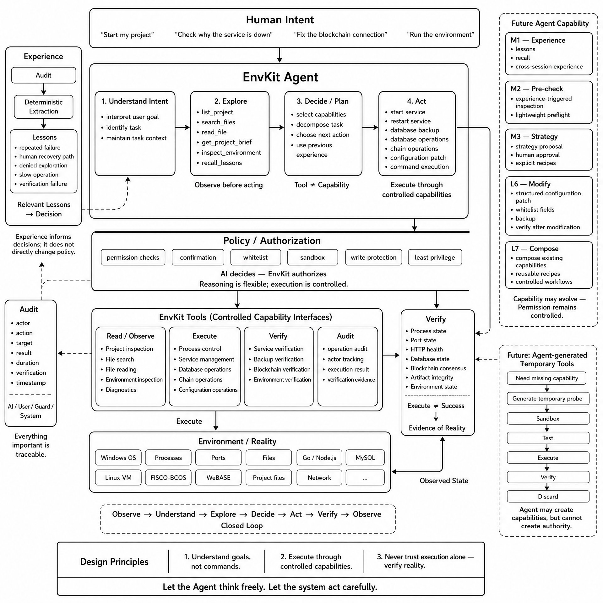
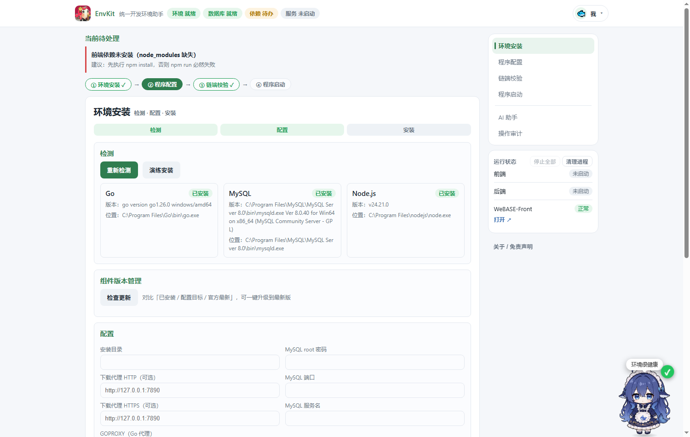

<div align="center">


# EnvKit

**Windows 上的可验证 Agent Runtime**

在一台新机器上完成 Go / Node.js / MySQL 安装、项目配置、FISCO-BCOS 链端运维、前后端启动；所有副作用由受控工具执行，执行完由验证器判断"到底成没成"。

[](https://go.dev)
[](https://github.com/hrui83771-gif/EnvKit)
[](https://github.com/hrui83771-gif/EnvKit/releases)
[](LICENSE)

</div>

---

## 它是什么

表面上看，EnvKit 是一个单文件 Windows 程序：双击运行，浏览器打开本地控制台，按四步完成环境安装、程序配置、链端校验、程序启动。

但它不只是一个"把命令包起来"的工具。**它更像一个面向 Windows 环境的 Agent Runtime**：

- 模型可以观察环境、规划、调用工具，但所有副作用必须经过受控工具层；
- 写操作由权限裁决器定档，需确认的必须由用户确认；
- 每次执行之后，由验证器用端口、进程、HTTP、备份内容、链端共识去判断结果；
- 每个任务都有轨迹，能回放到"谁、在什么时候、做了什么、结果如何"。

模型负责决策，Runtime 负责边界，Verification 负责结论。三者分开，是这个项目和普通 Agent 框架最大的区别。

## 一条原则：执行完成 ≠ 任务完成

命令返回 0、进程派生成功、备份文件生成、端口有人监听、区块高度在涨——这些只是**证据**，不是**结论**。

| 证据 | 不足以说明 | 因为 |
|---|---|---|
| 命令返回 0 | 服务可用 | 可能端口没绑上、进程随后退出 |
| 进程已派生 | 服务健康 | 可能绑错端口、被别的进程占住 |
| 备份文件已生成 | 能还原 | 可能缺触发器、校验和对不上、导出被截断 |
| 区块高度在涨 | 链在出块 | PBFT 空块只共识不落盘，静止本属正常 |

所以 EnvKit 把"是否完成"的判定权从模型手里拿走：模型可以决定做什么，但不能自己宣布完成。验证不过就显示「已执行，未验证」，只有客观证据通过才显示「已完成」。

支撑这条原则的是五个机制，各管一件事：

| 层面 | 解决什么 |
|---|---|
| Contract `OpResult{Ok, Verified, Evidence, ErrKind}` | 失败被外层吞掉后，模型只能硬编码"已启动" |
| Verification 服务 / 备份 / 链端验证器 | "命令成功"被误报成"环境已恢复" |
| Policy 四档权限裁决 | "什么算危险"散落在多处，换个入口就能绕过 |
| Trace 每任务完整轨迹 | 失败无法归因，经验退化成凭空总结 |
| Memory 记忆带作用域与置信度 | 把别的项目的经验套到当前项目 |

## Agent 架构



Agent 循环四步：**Observe → Reason → Act → Verify**。第四步不是"模型想起来才做"的收尾，而是和前三步同等地位的一环。

三条设计约束决定了异常情况下的行为：

1. **推理灵活，执行受控。** 模型可以自由决定调用顺序和组合，但所有副作用必须经过已注册的 26 个工具接口。EnvKit 不提供"执行任意命令"的能力。
2. **权限由系统裁定。** 工具返回成功只代表命令发出去了；能不能对用户说"已完成"，由验证器的客观结论决定。
3. **经验只影响决策，不改变权限。** 记忆层改变的是"先查什么、要不要原样重试"，不改变任何操作的授权档位。裁决器不读取任何记忆字段。

底层记录：计划、动作、证据、复验结论、人工确认，全部进轨迹与审计。跨会话仍能回答"上次那件事是怎么处理的"。

## 验证是怎么做的

- **服务**：进程在不在 → 端口有没有人听 → 监听者是不是这个进程 → HTTP 是否正常 → 观察窗内有没有崩。HTTP 5xx 判"进程在、端口在听，但服务端自报异常"，不判成功。
- **备份**：sha256 真复算 + 表 / 触发器 / 视图 / 存储过程完整性。文件完整不等于能还原，真实还原走「恢复演练」。
- **链端**：端口 + `fisco-bcos` 进程数 + 共识视图是否推进。空闲链块高不动是正常的，不能拿块高当判据；节点落后于网络时给"正在追赶"，不报"已恢复"。

## 主要功能

**环境安装**：Go / Node.js / MySQL 检测与安装，镜像加速、SHA256 校验、失败重试、演练安装。

**程序配置**：项目目录、MySQL、启动方式（自动推断或手填）、建库建表、备份 / 还原 / 恢复演练、配置导入导出（可脱敏）。

**链端运维**：SSH 密码或私钥登录、页面内嵌终端、节点端口 / 进程 / 共识检测、宕机自动恢复、后台守护、Windows 通知。

**程序启动**：前后端启动 / 停止 / 端口诊断；子进程绑定 Job Object，EnvKit 退出时自动回收；实时日志。

**AI 助手**：26 个受控工具，写操作先确认；复验结果用三态徽章展示（通过 / 已执行未验证 / 失败）；记忆与经验默认关闭，开启后可以查看每轮注入了哪些规矩；对话支持 Markdown、表格、代码高亮。

**行动与预案**：AI 抽屉的「行动」tab 把一次处置变成可持久化、可续作的行动——手动新建、定时巡检、守护降级、本机入站触发都会产出行动，断网断流或程序重启后点「继续」，从最后完成的步骤接着跑，不从头再来。行动收口后可以把步骤序列**存成预案**；下次同类故障（同服务 + 同错误类型）由预案预填步骤，写操作照样逐条过确认。预案连败 3 次自动进「待复审」，不再推荐。

**晨报**：按设置里的时刻（默认 08:30）产出一份只读报告——服务状态、近 24 小时崩溃与熔断、磁盘趋势、未收口的行动、组件与链端状态。全部来自系统记录，生成过程不经过模型；报告在行动列表里可直接查看或下载为 `.md`。

**从处置里学**：行动收口时会自动沉淀经验（目标级连败、你放弃 AI 后自己修好）；「取消」不算「修不好」——它记的是「未证明」，不参与任何失败统计。写操作永远不会因为「这条经验置信度高」而免确认，置信度只影响它排在第几位、要不要标「仅供参考」。

**成长报表**：行动 tab 下方按 ISO 周列出首次解决率、平均步数、用户修正率、预案命中率与预案有效率。全部从 `missions.json` / `playbooks.json` / 审计直接算出，不经模型转述；分母为 0 显示「—」而不是 0%，样本不足会明说「这个量级看不出趋势」。

**操作审计**：主体、动作、目标、结果、耗时、复验结论、trace_id，按天分文件保留 30 天。

**设置**：一页三区（基础 11 卡 / 开发者 8 组 / 评测四档）。日志配额、校验窗口、重试次数、AI 读取上限这些原本写死的常量都能改，改完即生效；更新检查默认每 3 天查一次 GitHub Releases；全局静音一键停掉所有主动通知。

**托盘**：右键打开控制台 / 程序配置 / 日志目录；隐藏窗口到托盘，退出前停掉前后端。

## 桌宠


右下角的大肥鱼不是装饰，是这个 Runtime 的"状态出口"：

- **状态联动**：待机、思考中、干活中、等待确认、出错各有动作；进度环显示当前任务进度，悬停能看到任务名、耗时、最近一条状态。
- **点它开 AI 抽屉**；有确认卡时它会举蓝色徽标，点徽标可以直接批准或拒绝，不用打开抽屉。
- **双击喂食**：五种食物，各有台词和进食动画。右键菜单可以归位、收起一会儿、听它说一句、调整大小三档、切换鼠标穿透、切换原地 / 溜达 / 跟随鼠标、打开 AI 抽屉、立即检测；开启天气后还会多一个「查看天气」。
- **拖入 .sql**：直接走"先备份 → 确认 → 执行"，执行期间它负责盯进度。
- **小动作**：按住 1.5 秒摸头，拖着甩会晕，连点 5 次回嘴、10 次撒花、15 次喷水。
- **称呼**：在个人中心设置昵称后，开场问候会带上名字。

形象与部分台词来自开源项目 [dafeiyu-pet](https://github.com/1190fasheqi/dafeiyu-pet)（MIT），完整声明见 [THIRD-PARTY-NOTICE.md](THIRD-PARTY-NOTICE.md)。

## 界面



## 快速开始

### 下载

从 [Releases](https://github.com/hrui83771-gif/EnvKit/releases) 下载 `EnvKit-v3.4.0-win64.zip`，解压后运行 `安装.bat`（复制到 `%LOCALAPPDATA%\EnvKit` 并建桌面快捷方式），或直接双击 `EnvKit.exe`——单文件、免安装。控制台默认 `http://127.0.0.1:18765`，端口冲突时自动避让。

### 从源码构建

```bash
git clone https://github.com/hrui83771-gif/EnvKit.git
cd EnvKit
go build -trimpath -ldflags "-s -w" -o EnvKit.exe .
```

需要 Go 1.26 或更高。图标与版本信息已通过 `resource.syso` 编进 exe。

### 运行前提

- Windows 10 / 11 x64
- MySQL 绿色版需要 [VC++ 2019 Redistributable (x64)](https://learn.microsoft.com/zh-CN/cpp/windows/latest-supported-vc-redist)
- 注册或启动 MySQL 服务需要管理员权限
- 首次安装组件需要联网（约 180 MB，可配下载代理）

## 配置

`config.json` 放在 exe 同目录，覆盖内置默认值；`config.dist.json` 是干净模板。涵盖组件版本与下载地址、GOPROXY、npm registry、MySQL 参数、项目目录、链端 SSH、托盘状态等。

API Key 与数据库密码经 Windows DPAPI 加密，只在本机可解密。

## 安全边界

- 所有写操作先过权限裁决：`auto` / `confirm` / `elevated` / `forbidden`，禁止档在派发前终止
- 需确认的动作由服务端返回 428 强制确认，模型跳不过去
- 只暴露受控工具，不提供任意命令执行
- 文件探索限制在已配置的项目目录内
- 记忆只影响建议，不改变任何操作的权限档位
- SSH 首次连接按 TOFU 记录主机指纹，之后变化即拒绝

## 评测

仓库里有单元测试、浏览器回归，以及 11 类故障注入评测（每类 3 次真实调用），观察模型是否查了、判对了、不越权、不谎报、该复验时复验。评测本身抓到过三个真实缺陷：备份校验"假绿"、大文件截断误报、评测装置在测旧构建。

方法和原始数据在 [`docs/eval/`](docs/eval/)。README 不贴会过期的数字。

## 项目结构

Go 代码在模块根（`package main`），Windows 平台相关代码在 `internal/platform`。前端源码在 `web/src/`，构建时拼成单文件 `web/index.html`，再用 `go:embed` 打进 exe。

改前端只改 `web/src/`，然后 `python tools/web_build.py` 重拼；直接改 `web/index.html` 会在下次构建时被覆盖。

逐文件职责见 [`docs/CODEMAP.md`](docs/CODEMAP.md)，设计取舍见 [`docs/architecture.md`](docs/architecture.md)。

## 版本

当前 **3.6.0**（已发布）。v3.5 把 Agent 闭环走完（预案库、告警闭环、晨报、行动→经验自动沉淀、成长报表）；v3.6 修了三个「结论报错」的缺陷（记忆列表把存在报成不存在、只读行动被判 failed、预案删除被侧栏遮挡）。改动见 [`docs/RELEASE-v3.6.0.md`](docs/RELEASE-v3.6.0.md)，设计与偏离见 [docs/DESIGN-agent-loop.md](docs/DESIGN-agent-loop.md)，历史路线见 [`docs/ROADMAP.md`](docs/ROADMAP.md)。

闭环的**接缝**由 `agent_loop_e2e_test.go` 一条测试覆盖（告警 → 预案 → 起草 → 执行 → 复验 → 收口 → 沉淀 → 复用 → 降级 → 经验召回，不调模型）。单模块单测测不出接缝问题：历史上两次真实断链都发生在接缝上，而当时所有单测都是绿的。

## 许可证

[MIT](LICENSE)。

第三方：桌宠素材 dafeiyu-pet（MIT）、托盘库 systray（Apache-2.0）、前端内嵌 marked（MIT）与 highlight.js（BSD-3-Clause）。完整许可见 [THIRD-PARTY-NOTICE.md](THIRD-PARTY-NOTICE.md)。

## 免责声明

本软件按「现状」提供，作者不对准确性、可靠性、适用性作担保，使用后果由使用者自行承担。依赖的第三方组件（Go、Node.js、MySQL、FISCO-BCOS、WeBASE 等）版权归各自权利方所有。链上数据仅供参考，不构成投资或商业建议。完整声明见软件内「关于 / 免责声明」。
